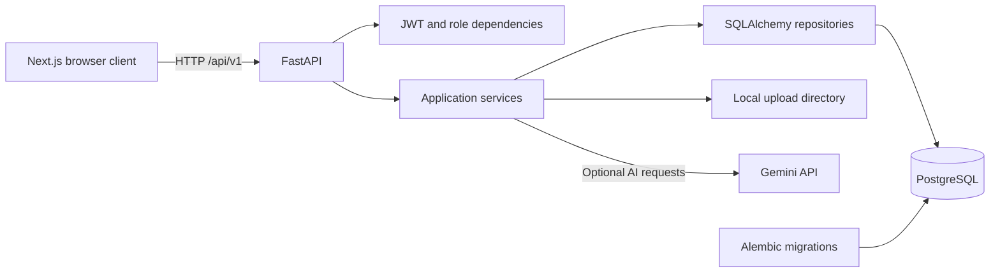

# AI-LMS

AI-LMS is a learning management system with a FastAPI backend and a Next.js web client. It supports student, teacher, and admin accounts; course delivery; quizzes and assignments; dashboards; and optional Gemini-powered study tools.

## Features

- JWT access and refresh tokens, bcrypt password hashing, and role checks for teacher and admin operations.
- Course creation and publishing, lessons, course files, student enrollment, and lesson progress.
- Quiz creation (manual or AI-generated), attempts, answer records, and score history.
- Assignments, student submissions, and teacher grading.
- Student, teacher, and admin dashboard APIs, plus paginated course search.
- Optional Gemini API integration for tutor chat, notes, summaries, flashcards, study plans, quiz generation, and recommendations.
- Validated uploads for course resources, lesson media, avatars, and assignment submissions.

The API has email verification and password reset endpoints and stores their tokens, but SMTP delivery is not implemented. The AI recommendation prompt currently receives the student ID and optional course and published lesson titles; it does not calculate recommendations from quiz scores or lesson progress. Billing, paid subscriptions, and standalone learning paths are not implemented.

## Tech stack

| Area | Technology |
| --- | --- |
| Backend API | Python, FastAPI, Pydantic |
| Database | PostgreSQL, async SQLAlchemy, Alembic |
| AI provider | Google Gemini API (optional) |
| Frontend | Next.js App Router, React, TypeScript, Tailwind CSS |
| Tests and lint | pytest, pytest-asyncio, Ruff, ESLint, TypeScript |
| Local services | Docker Compose |

## Architecture



<!-- Screenshot placeholder: add a student dashboard image at docs/screenshots/student-dashboard.png. -->
<!-- Screenshot placeholder: add a course lesson image at docs/screenshots/course-lesson.png. -->

## Requirements

- Docker Desktop for the local PostgreSQL service.
- Python 3.12 or newer for local backend tools.
- Node.js 20.9 or newer and npm for the frontend.
- A Gemini API key only if you want to use AI endpoints.

## Local setup

1. Copy `.env.example` to `.env`. Generate `SECRET_KEY` with `python -c "import secrets; print(secrets.token_hex(32))"`, and replace the database password placeholder with a URL-safe value. Set `GEMINI_API_KEY` only if you need AI features.
2. Start PostgreSQL and the API:

   ```bash
   docker compose up --build -d
   docker compose exec api alembic upgrade head
   docker compose exec api python -m scripts.seed_demo
   ```

3. Start the frontend in another terminal:

   ```bash
   cd frontend
   npm ci
   cp .env.local.example .env.local
   npm run dev
   ```

4. Open `http://localhost:3000`. The backend is at `http://localhost:8000`; interactive API docs are at `/docs`.

The Compose service passes the database URL to the API using the `postgres` service name. To run the API directly on the host, set `DATABASE_URL` to a host-reachable PostgreSQL URL first. Do not commit `.env` or `.env.local`.

## Demo account

Run the seed command after migrations. It creates sample teacher and student accounts, a published Python course, one lesson, and a student enrollment. The seed is idempotent and does not overwrite existing accounts.

| Role | Email | Password |
| --- | --- | --- |
| Student | `demo@ai-lms.local` | `DemoOnly123!` |
| Teacher | `teacher-demo@ai-lms.local` | `DemoOnly123!` |

These credentials are for a disposable demo database only. Do not use them for real users or production data. The demo student login is the recommended recruiter tour.

## Environment variables

| Variable | Required | Purpose |
| --- | --- | --- |
| `DATABASE_URL` | Yes | Async SQLAlchemy URL (`postgresql+asyncpg://...`) |
| `SECRET_KEY` | Yes | JWT signing key; use a random value of at least 32 characters |
| `APP_NAME`, `APP_VERSION` | No | API name and version |
| `ENVIRONMENT` | No | Environment label; `production` enables HSTS |
| `DEBUG` | No | SQL echo and development setting; keep `false` in deployment |
| `ALGORITHM` | No | JWT algorithm; supported value is `HS256` |
| `ACCESS_TOKEN_EXPIRE_MINUTES` | No | Access token lifetime (default 60) |
| `REFRESH_TOKEN_EXPIRE_DAYS` | No | Refresh token lifetime (default 7) |
| `DATABASE_POOL_SIZE`, `DATABASE_MAX_OVERFLOW` | No | Async PostgreSQL pool sizing |
| `DATABASE_SSL` | No | Enable TLS for PostgreSQL connections (default `false`) |
| `CORS_ORIGINS` | No | JSON array of explicit browser origins; wildcard is rejected |
| `UPLOAD_DIR` | No | Local upload directory (default `./uploads`) |
| `MAX_UPLOAD_SIZE_MB` | No | Maximum upload size (default 50 MB) |
| `ALLOWED_IMAGE_TYPES`, `ALLOWED_VIDEO_TYPES`, `ALLOWED_DOCUMENT_TYPES` | No | JSON arrays of accepted MIME types |
| `GEMINI_API_KEY` | For AI | Gemini API key; leave empty to disable AI operations |
| `GEMINI_MODEL` | No | Gemini model name |
| `RATE_LIMIT_PER_MINUTE`, `AI_RATE_LIMIT_PER_MINUTE` | No | Per-IP request limits |
| `SMTP_HOST`, `SMTP_PORT`, `SMTP_USERNAME`, `SMTP_PASSWORD` | No | Reserved SMTP configuration; no email sender is implemented |
| `EMAILS_FROM_EMAIL`, `EMAILS_FROM_NAME` | No | Sender labels for a future email integration |
| `POSTGRES_USER`, `POSTGRES_PASSWORD`, `POSTGRES_DB` | Compose | Local PostgreSQL container credentials |
| `NEXT_PUBLIC_API_URL` | Frontend | Backend origin without `/api/v1` (default `http://localhost:8000`) |

## API overview

All application routes use `/api/v1`.

| Group | Main routes |
| --- | --- |
| Authentication | `/auth/register`, `/auth/login`, `/auth/refresh`, `/auth/me`, `/auth/verify-email`, `/auth/forgot-password`, `/auth/reset-password`, `/auth/change-password` |
| Users | `/users/me`, `/users/`, `/users/{user_id}` |
| Courses and lessons | `/courses`, `/courses/{course_id}/lessons`, `/lessons/{lesson_id}`, `/lessons/{lesson_id}/progress` |
| Enrollments | `/enrollments`, `/enrollments/my`, `/enrollments/{course_id}/status` |
| Quizzes | `/courses/{course_id}/quizzes`, `/quizzes/{quiz_id}/attempts`, `/quizzes/students/quiz-history` |
| Assignments | `/courses/{course_id}/assignments`, `/assignments/{assignment_id}/submit`, `/submissions/{submission_id}/grade` |
| AI | `/ai/chat`, `/ai/notes/generate`, `/ai/summarize`, `/ai/flashcards/generate`, `/ai/study-plan/generate`, `/ai/recommendations` |
| Dashboards and search | `/dashboard/student`, `/dashboard/teacher`, `/dashboard/admin`, `/search/courses` |
| Health | `/health`, `/api/v1/health` |

The route modules and request/response schemas are in `app/api/v1/` and `app/schemas/`. Use `/docs` to inspect the generated OpenAPI document.

## How AI recommendations work

AI calls go to the configured Gemini model through `google-genai`; no local model weights are stored in this repository. The recommendation service includes the authenticated user's ID and, when a course is supplied, the course name and up to ten published lesson titles in its prompt. Gemini returns a JSON recommendation shape. If Gemini is unavailable or the key is missing, AI operations return a service-unavailable response. Configure the API key on the backend only.

## Tests and quality checks

Create a virtual environment, install the development dependencies, and run the automated suite and static checks:

```bash
python -m venv .venv
# Windows: .venv\Scripts\Activate.ps1
# macOS/Linux: source .venv/bin/activate
python -m pip install -r requirements-dev.txt
ruff check app tests alembic
ruff format --check app tests alembic
pytest -q
```

Tests that make live Gemini calls are opt-in with `RUN_LIVE_AI_TESTS=true`; they also require a valid API key and can use provider quota. Recommendation route coverage uses a deterministic stub and does not call Gemini.

Frontend checks:

```bash
cd frontend
npm ci
npm run lint
npm run type-check
npm run build
```

## Live demo

`https://<your-deployed-frontend-url>` (replace after deployment).

## License

No license file is currently included.
